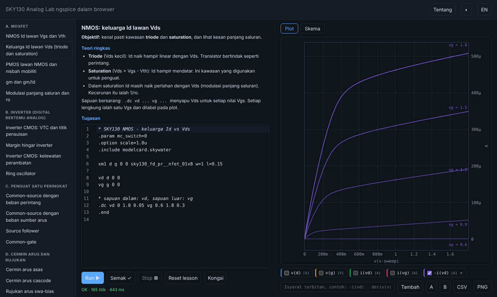
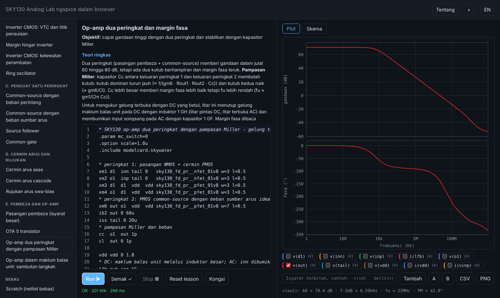
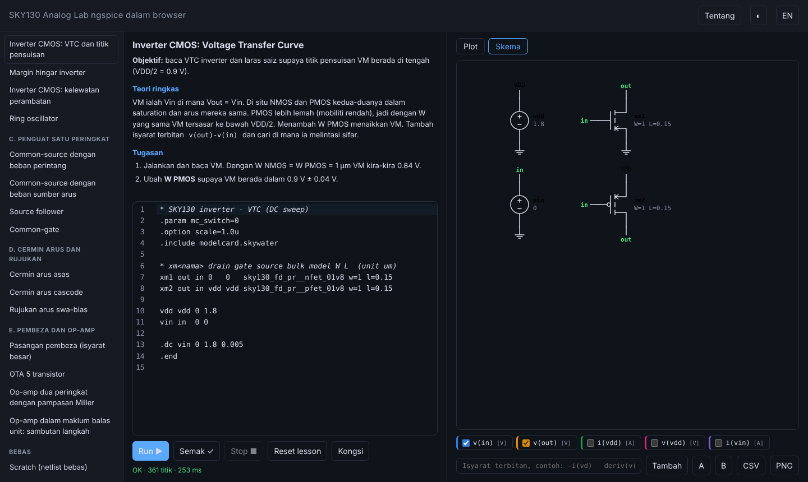
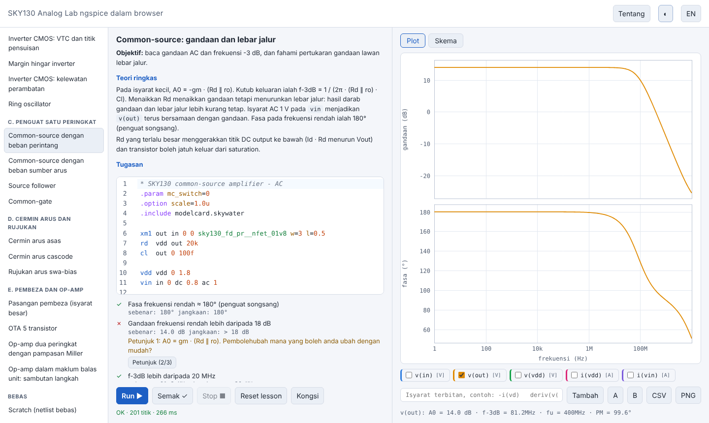

# SKY130 Analog Lab

Makmal analog IC yang jalan **terus dalam browser**: ngspice dalam WebAssembly dengan model transistor **SkyWater SKY130**.
Tak perlu Linux, Xschem, Magic atau install PDK. Ada 20 lesson berpandu (modul A hingga E) dengan semakan automatik.



| Bode op-amp | Skema | Tema terang + lesson |
| --- | --- | --- |
|  |  |  |

## Cara run (Windows)

1. Install **Node.js LTS** dari https://nodejs.org
2. Buka PowerShell dalam folder projek:

```powershell
npm install
npm run dev
```

3. Buka http://localhost:5173 dalam Chrome atau Edge. Tekan **Run** (atau `Ctrl+Enter` dalam editor).

| Perintah | Fungsi |
| --- | --- |
| `npm test` | Vitest: unit, dan setiap `circuit.cir` / `solution.cir` lesson melalui engine ngspice |
| `npm run test:cov` | Sama, dengan liputan (ambang 90% untuk `measure.js`, `expr.js`, `signals.js`) |
| `npm run test:e2e` | Playwright (dev server) |
| `npm run test:e2e:pwa` | Playwright atas build produksi: service worker dan mod luar talian |
| `npm run build` | Hasilkan `dist/` untuk GitHub Pages |

Set `PW_CHROMIUM=/laluan/ke/chrome` kalau nak guna binary Chromium sedia ada, selain `npx playwright install chromium`.

## Ciri

- **Engine dalam Web Worker**: UI tak beku; butang **Stop** dan timeout 20 s memulakan semula engine.
- **Plot**: dua paksi Y, sapuan `.dc` bersarang (lengkung berlabel), **Bode** untuk `.ac` (A0, f-3dB, fu, margin fasa),
  zoom (roda), pan (seret), dwiklik reset, dua kursor A/B dengan Δx dan Δy, eksport CSV dan PNG.
- **Isyarat terbitan** tanpa `eval`: `-i(vd)`, `v(out)-v(in)`, `deriv(v(out))`, `db(...)`, `abs(...)`.
- **Editor CodeMirror 6**: highlight SPICE, garis bawah ralat ngspice pada baris yang betul, hint sebelum run
  (header SKY130, `m1` lawan `x`, W/L dalam meter, tiada analisis), autosave, **pautan kongsi** (`#s=...`), mod **Scratch**.
- **Kursus berpandu**: sidebar modul, butang **Semak** dengan nilai sebenar lawan jangkaan, tangga petunjuk (dua petunjuk teks, kemudian beza penyelesaian), tanda siap.
- **Skema**: tab Skema melukis litar; klik label net untuk menogol `v(net)` dalam plot.
- **BM / English**, tema terang/gelap, susun atur responsif (360 px), papan kekunci dan `aria`, dialog **Tentang** dengan kredit.
- **PWA**: selepas dimuat sekali (engine ~20 MB, 5.8 MB gzip) lab berfungsi luar talian.

## Kurikulum

| Modul | Lesson |
| --- | --- |
| A. MOSFET | Id-Vgs dan Vth, keluarga Id-Vds, PMOS lawan NMOS, gm dan gm/Id, modulasi panjang saluran |
| B. Inverter | VTC dan VM, margin hingar, kelewatan perambatan, ring oscillator |
| C. Penguat satu peringkat | common-source (perintang), common-source (beban arus), source follower, common-gate |
| D. Cermin arus dan rujukan | cermin asas, cascode, rujukan swa-bias |
| E. Pembeza dan op-amp | pasangan pembeza, OTA 5T, dua peringkat Miller, pengikut voltan (sambutan langkah) |

Modul F (PTAT/CTAT, bandgap, comparator, capstone) dijadualkan untuk v1.1.

## Cara tambah lesson

Cipta folder `src/lessons/<id>/` dengan:

- `lesson.md`: frontmatter (`title`, `module` A-F, `order`) + teori BM, objektif dan tugasan.
- `circuit.cir`: litar permulaan. Mesti simulate tanpa ralat dan **gagal sekurang-kurangnya satu semakan** (itulah tugasan).
- `checks.js`: `export const checks = [{ id, label, run(result, h) => ({pass, actual, expected}), hints: [..maks 2] }]`.
  `h` ada `sig(name)`, `mag`, `phase`, `x`, `segments`, `deriv(y)` dan semua fungsi dalam `src/measure.js`.
- `solution.cir`: penyelesaian. Mesti lulus semua semakan. Petunjuk ketiga ialah beza litar lawan penyelesaian.
- `layout.json` (pilihan): `{"xm1": [lajur, baris]}` untuk meletakkan simbol skema dengan tangan.

Lesson dipungut automatik (`import.meta.glob`) dan `npm test` mengesahkannya melalui engine. Komen dalam `checks.js` mesti merekod
nilai rujukan daripada simulation dan pengiraan tangan. Bin W/L SKY130 terhad, lihat `docs/engine-notes.md`
(contoh `w=2 l=0.5` tak sah; W = 1, 3, 5, 7 sah untuk semua L).

Butang **EN/BM** di header menukar UI dan lesson. Terjemahan UI: `src/i18n/en.json`. Terjemahan lesson: `lesson.en.md` dan `checks.en.json` (label dan petunjuk ikut `id` semakan) dalam setiap folder lesson; `npm test` pastikan semuanya lengkap.

## Seni bina

```
 index.html ── src/main.js (UI, keadaan) ───────────────────────────────┐
                │                                                      │
   src/editor.js (CodeMirror)      src/plot.js (canvas)      src/schematic/{parse,layout,render}.js
   src/lint.js, src/errors.js      src/signals.js, src/expr.js, src/measure.js
                │                                                      │
        src/engine/client.js ──postMessage──▶ src/engine/worker.js ──▶ eecircuit-engine (ngspice WASM + SKY130)
                                                                       │
   src/lessons/<id>/{lesson.md, circuit.cir, checks.js, solution.cir}  ─┘ (dipungut oleh src/lessons/index.js)
   public/sw.js + manifest.webmanifest (PWA)      src/i18n/{ms,en}.json
```

## Had yang diketahui

- Hanya `nfet_01v8`, `pfet_01v8` dan `pfet_01v8_hvt` ialah peranti SKY130 sebenar dalam engine (`docs/device-support.md`).
  Perintang, kapasitor, sumber dan BJT dalam lesson ialah **elemen SPICE ideal**.
- Model SKY130 "binned": kombinasi W/L tertentu sahaja yang sah.
- Hanya sudut `tt`; tiada Monte Carlo. Tiada layout, DRC atau LVS.
- Skema ialah paparan sahaja (label net, bukan wayar). Editor skema dijadualkan v1.1.
- Ungkapan terbitan tidak disokong untuk keputusan `.ac`.
- Nama sebahagian peranti dan istilah dalam komen `checks.js` kekal dalam BM.
- Engine ~20 MB: muat turun pertama lambat; selepas itu dicache.
- Simulation tidak boleh diinterupsi dengan bersih; Stop membuang worker dan mencipta yang baru.

## Lesen

MIT. Lihat `LICENSE` dan `NOTICE` (eecircuit-engine MIT, ngspice, SkyWater PDK Apache-2.0).
